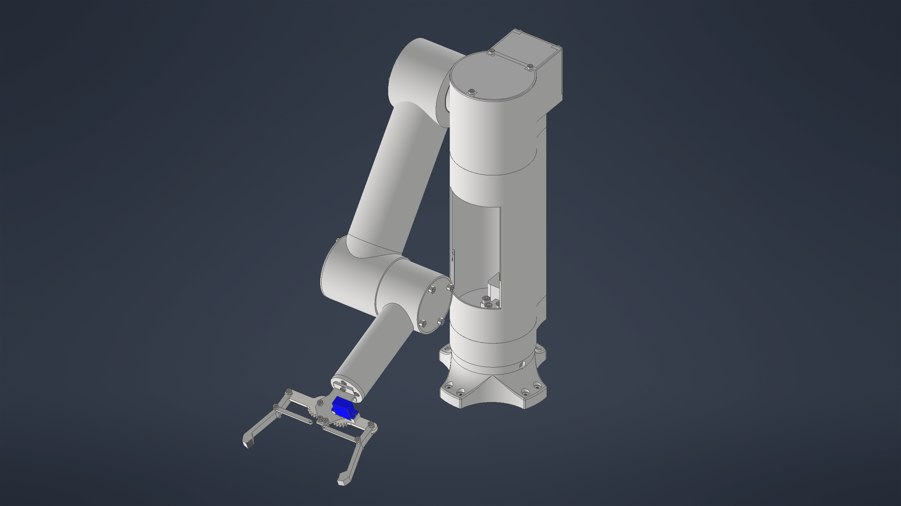

# Robotic Manipulator — CAD Design 🤖

A 3D mechanical design of a robotic manipulator developed in **Autodesk Inventor**.

The project focuses on robotic arm construction, mechanical joints, component modeling, and assembly design.

## Project Overview

The robotic manipulator consists of an articulated arm with multiple joints and a mechanical gripper.

The project demonstrates practical skills in:

- 3D mechanical modeling
- Designing robotic joints and mechanisms
- Creating complex CAD assemblies
- Mechanical component integration
- Robotic arm and gripper design

## Technologies

- Autodesk Inventor
- 3D CAD Modeling
- Mechanical Design
- Robotic Manipulators
- Assembly Modeling

## Project Files

The repository contains:

- **IPT files** — individual mechanical components
- **IAM files** — robotic manipulator assemblies
- **IPJ file** — Autodesk Inventor project configuration, if provided
- **PNG images** — visualization of the completed CAD model

📁 [View Autodesk Inventor Project](Inventor_Project/)

## Project Purpose

The main objective was to develop practical skills in designing mechanical systems and assembling complex robotic structures using CAD software.

The project represents a mechanical CAD design, not a physically manufactured or programmed robot.
